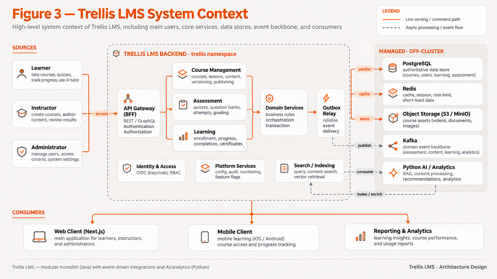
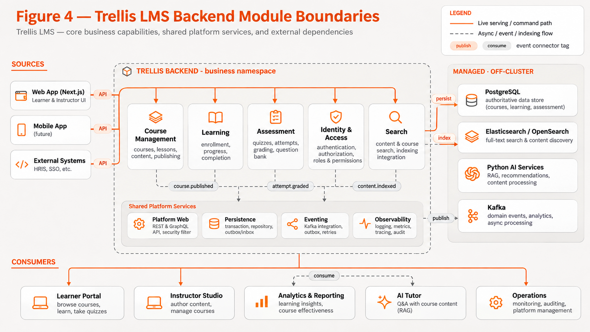
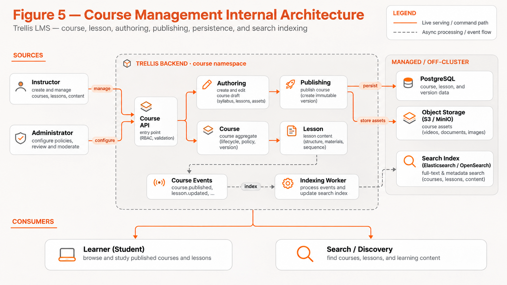
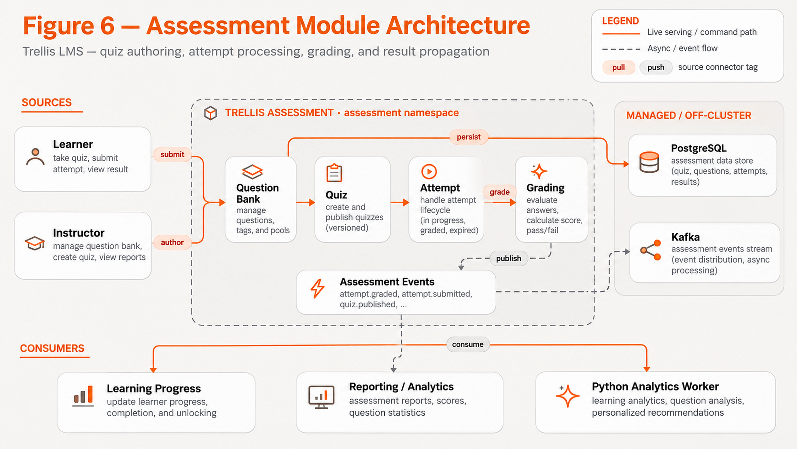
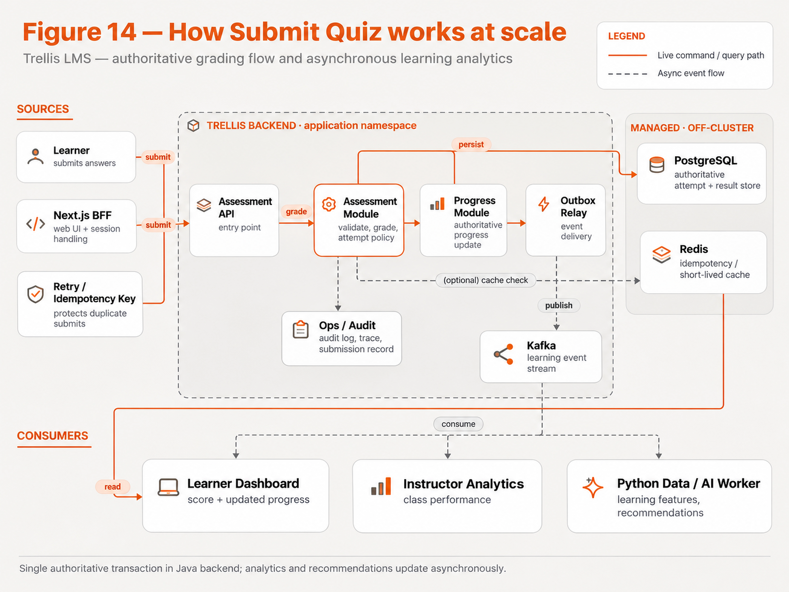
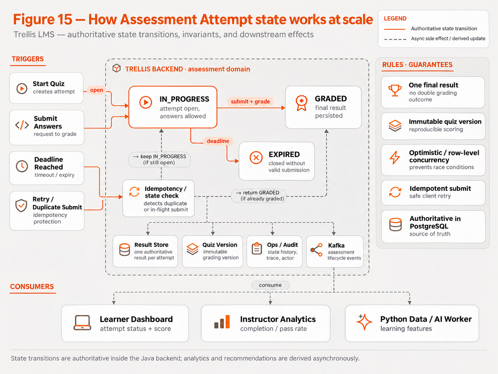
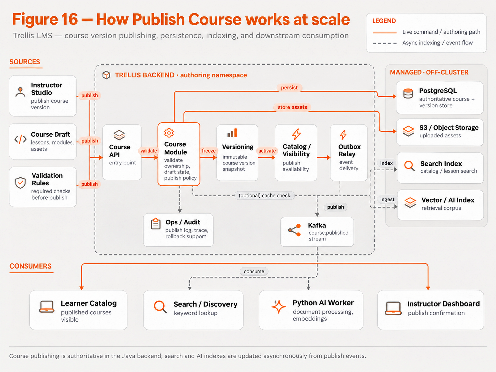
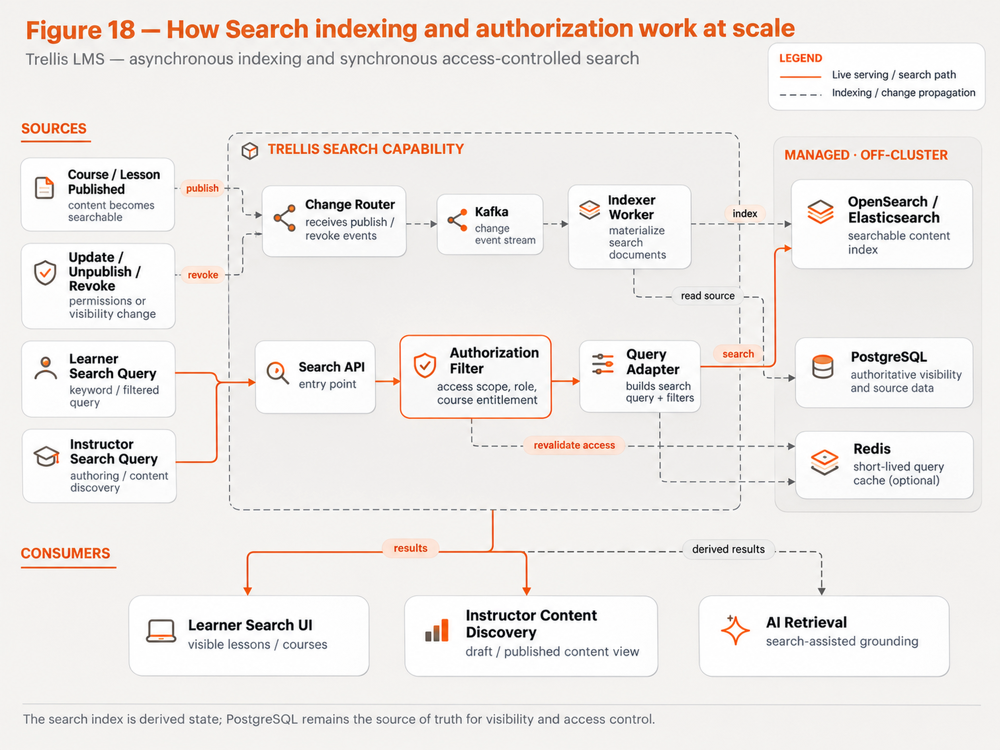

# Trellis

A source base for large Java + Python + TypeScript monorepos, following DataHub's engineering
standards. It contains the platform skeleton and one small sample feature (`notice`), no business
domain. Products are generated from it.

Read [AGENTS.md](AGENTS.md) before changing anything.

## Architecture

These diagrams describe the Trellis LMS product built on this base. The base itself ships the platform skeleton, the `notice` sample feature and the `trellis-learning-content` module, so not every box below exists as code yet.

### Figure 3: Trellis LMS system context

Who uses the system, the modular monolith in the middle, the stores it owns and the event backbone to the Python consumers.



### Figure 4: Backend module boundaries

The business capabilities, the shared platform services and what each depends on.



### Figure 5: Course management: internal architecture

Authoring, lesson structure and version publishing, and how a published course reaches search.



### Figure 6: Assessment module architecture

Question bank, quizzes, attempts and grading, and how results propagate to progress and analytics.



### Figure 14: How submitting a quiz works at scale

Authoritative grading in Java with an idempotent submit; analytics update asynchronously from events.



### Figure 15: How assessment attempt state works at scale

The attempt state machine (in progress, graded, expired) and the guarantees around it.



### Figure 16: How publishing a course works at scale

Versioned publishing: Java owns publish, while search and AI indexes are derived asynchronously.



### Figure 18: How search indexing and authorization work at scale

Asynchronous content indexing with synchronous, access-controlled search. PostgreSQL stays authoritative for visibility.



## What lives where

Trellis is three repos (decision T21). This one is the backend; it also owns the contracts the other
two generate their clients from, and the local stack they run against.

| Repo | Runtime | What it is | Rules |
| --- | --- | --- | --- |
| **`trellis-backend`** (this one) | Java 21, Spring Boot 4, Gradle | Owns the database and every business rule. Serves REST (commands, integrations) and GraphQL (read models for the UI), authorizes every call, writes the audit trail, and publishes domain events through a transactional outbox. | [`AGENTS.md`](AGENTS.md), [`docs/architecture/backend.md`](docs/architecture/backend.md) |
| [`trellis-web`](https://github.com/Tam107/trellis-web) | Node 22, Next.js 15, TypeScript | The frontend, and the BFF: the browser only ever calls `/api/*` on that server, which forwards here, so no API token reaches the browser. | [`AGENTS.md`](https://github.com/Tam107/trellis-web/blob/main/AGENTS.md) |
| [`trellis-ai`](https://github.com/Tam107/trellis-ai) | Python 3.12, uv | RAG, Kafka workers, the backend SDK and the `trellis` CLI. Everything that runs outside an HTTP request. | [`AGENTS.md`](https://github.com/Tam107/trellis-ai/blob/main/AGENTS.md) |

How the three talk to each other, and what keeps them from drifting apart:
[`docs/architecture/cross-repo.md`](docs/architecture/cross-repo.md).

| Directory here | What it is |
| --- | --- |
| `trellis-common` … `trellis-app` | the Java modules (map below) |
| `contracts/` | Event JSON Schemas, the exported OpenAPI document and GraphQL schema, shared test vectors. The TypeScript and Python clients are generated and published from these; CI fails if a generated file drifts. Never hand-edit a generated file. |

Supporting directories: `build-logic/docker/` (images and the local stack), `build-logic/ci/` (GitLab pipeline),
`build-logic/scripts/dev/` (`trellis-dev.sh`, the local stack helper), `docs/` (architecture and ADRs),
`.agent-skills/` and `.claude/` (agent tooling).

### How a change flows through them

A new feature usually touches all four, in this order:

1. `contracts/` — define or version the event payload.
2. `backend/domains/<name>/` — domain, use cases, SQL, REST and GraphQL, outbox event.
3. `trellis-ai` — a consumer for the event, if something must happen asynchronously.
4. `web/` — regenerate the client, then build the screens.

### Backend module map

Gradle project names stay flat (`:trellis-app`) while directories say what each module is:

```text
backend/
├── trellis-common/            plain Java, no Spring: error model, context, ids, paging, AOP annotations
├── trellis-platform/
│   ├── base/          Spring infrastructure: persistence, authorization, observability, AOP aspects
│   ├── events/        outbox, relay, inbox, transports (Kafka or in-memory), dead letters
│   └── web/           REST, GraphQL, OpenAPI, the security filter chain
├── trellis-notice/            the sample business module — copy this to start a real one
└── apps/app/          the deployable that assembles everything
```

A business module is layered inside: `api` (what other modules may import) → `domain` →
`application` → `infrastructure` → `web`. See [`AGENTS.md`](AGENTS.md) and
[`docs/guide/trellis-common.md`](docs/guide/trellis-common.md).

## Quick start

Thêm một nghiệp vụ mới: [docs/guide/new-module.md](docs/guide/new-module.md).
Dùng `trellis-common` (annotation, utils, thêm thứ mới ở đâu): [docs/guide/trellis-common.md](docs/guide/trellis-common.md).
Ba repo tương tác với nhau: [docs/architecture/cross-repo.md](docs/architecture/cross-repo.md).

Chi tiết hơn, gồm cả web và trellis-ai: [docs/guide/running.md](docs/guide/running.md).

## Quality gates

Each tree is checked on its own, and CI runs the same commands.

```bash
./gradlew build spotlessCheck :trellis-app:checkApiContracts
```

```bash
cd web && pnpm typecheck && pnpm lint && pnpm test && pnpm i18n:check && pnpm build && pnpm budget:check && pnpm codegen:check
```

```bash
cd workers && uv lock --check && uv run ruff check && uv run mypy && uv run pytest
```
