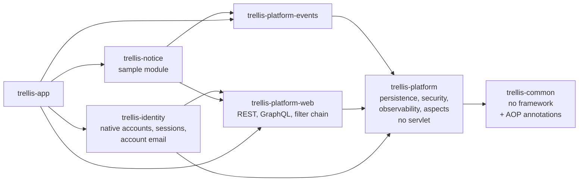
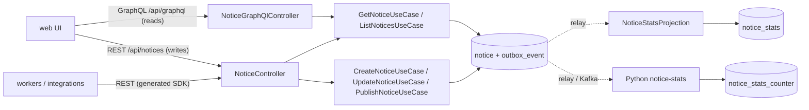

# Backend architecture

The Java platform of Trellis: what each part does, why it is shaped that way, and where the code is. Rules
for writing code live in [AGENTS.md](../../AGENTS.md) and
[Java and JUnit conventions](../guide/java-testing-conventions.md); recorded architecture decisions
are in [ADRs](../adr/).

## 1. Shape

A modular monolith. Platform modules are libraries that register themselves through Spring Boot
auto-configuration; `trellis-app` assembles them and will host business modules.



Runtime ports: API 8080, actuator 8081 (never routed publicly). Profiles: `dev`, `test`, `prod`; app modes
`setup` and `migrate` (one-shot, exit code is the result).

## 2. A request

```text
client ─▶ ServerHttpObservationFilter (span) ─▶ CorrelationIdFilter (X-Correlation-Id, MDC)
       ─▶ RequestLoggingFilter ─▶ Spring Security (native opaque token or OIDC JWT → Actor; @PublicEndpoint bypass)
       ─▶ AmbientRequestContextFilter (actor → MDC, RequestContext bound for edge code)
       ─▶ controller(RequestContext ctx, …)            [thin]
       ─▶ application service (AOP chain, @Transactional, outbox.append)
       ─▶ JPA repository / JdbcClient / OutboxWriter
error anywhere ─▶ ProblemMapper chain ─▶ RFC 7807 body (code, correlationId, traceId), 5xx detail hidden
```

`RequestContext` (actor, correlationId, traceId, locale, tenant placeholder, requestTime) is passed
explicitly as the first parameter of application services (DataHub's `OperationContext` lesson, 04 top 1).
The thread-bound `AmbientRequestContext` exists only for edges: filters, consumers, executors, and aspects on
methods that lack an explicit context.

## 3. AOP chain (T8)

```text
HTTP controller: RateLimited → application service
Application service: LogExecution → RequiresFeature → RequiresPermission → Idempotent → DistributedLock
  → [ Transactional → Audited → @Observed → method ]
```

| Position | Why here |
| --- | --- |
| LogExecution outermost in the application chain | sees outcomes of inner application advice and the method duration |
| RequiresFeature | rejects disabled application operations before business work and authorization |
| RateLimited on the controller | HTTP throttling precedes application authorization without quota calls in business logic |
| RequiresPermission before Idempotent | an unauthorised caller must not receive someone else's stored result by replaying a key |
| Idempotent before lock and tx | a replay costs one indexed read: no lock, no transaction; the result is stored after commit |
| DistributedLock outside tx | released after commit, so the next holder sees committed data |
| Audited inside tx | the audit row commits or rolls back with the change |
| @Observed innermost | Micrometer's `ObservedAspect` has no order; it measures the method body |

`@EnableTransactionManagement(order = AspectOrder.TRANSACTION)` pins the transaction advisor into the chain.
`AspectOrderingTest` asserts the advisor chain of a real proxy and journals what each collaborator observes
(including whether a transaction is active). ArchUnit enforces: annotations only on public, non-final methods
of beans in `..application..` packages (except `@RateLimited`, on public controllers), no
self-invocation of annotated methods, `@Audited` implies
`@Transactional`. Startup verifiers fail on unknown permissions and unknown feature flags.

## 4. Events (T11)

```mermaid
sequenceDiagram
  participant S as Application service
  participant DB as Postgres
  participant R as OutboxRelay (per shard)
  participant B as Broker (kafka | inmemory)
  participant C as EventDispatcher
  S->>DB: business change + INSERT outbox_event (same tx, MANDATORY)
  loop every 0.5 s, per shard
    R->>DB: pg_try_advisory_xact_lock(base+shard)
    R->>DB: due heads of key (no older NEW/FAILED for the key)
    R->>B: send batch (≤1 row per key), wait acks
    R->>DB: PUBLISHED | attempts+1 (→FAILED) | defer (broker down, no attempt spent)
  end
  B->>C: message (+ x-event-id, x-correlation-id, traceparent, x-event-version)
  C->>DB: tx: INSERT processed_event ON CONFLICT DO NOTHING; handler side effects
  C-->>B: on failure: retry with Backoff, then DLQ <type>.dlq (CONTINUE) or stop (THROW)
```

- **Ordering**: `partition_key` (default `Aggregate:id`) is also the Kafka key; the head-of-key predicate
  stops a row in backoff or a FAILED row from being overtaken; shards (`crc32(key) mod N`) let N relays run in
  parallel without interleaving a key. A FAILED row blocks its key on purpose.
- **Broker outage**: `TransportDown` defers rows without spending attempts, so an outage longer than the
  backoff ladder never poisons keys (verified: Kafka stopped, row stayed `NEW attempts=0`, published after
  restart).
- **At least once**: the relay can re-send after a crash; consumers dedupe in `processed_event` inside the
  handler transaction.
- **Transport**: `trellis.events.transport=inmemory` (default, single process, async delivery thread) or
  `kafka` (producer `acks=all`, idempotent, 5 s max block). `postgres` transport is planned for v0.2.
- **Recovery**: `EventOperations.replayDeadLetters` (DLQ → original topic) and `rebuildReadModel`
  (`ReadModelRebuilder` SPI, the `RestoreIndices` lesson), exposed under `/api/ops/**`, permission-guarded,
  locked and audited.
- **Metrics**: `outbox_oldest_new_age_seconds`, `outbox_rows{status}`, `outbox_relay_sent_total{outcome}`,
  `outbox_relay_pass_seconds`, `inbox_duplicate_total{consumer}`.

### Outbox runbook

```sql
-- Stuck keys and why
SELECT partition_key, id, event_type, attempts, last_error FROM outbox_event WHERE status = 'FAILED' ORDER BY id;
-- After fixing the cause: release one row
UPDATE outbox_event SET status = 'NEW', attempts = 0, next_attempt_at = now(), last_error = NULL
 WHERE id = :id AND status = 'FAILED';
-- Replay a published range (consumers are idempotent)
UPDATE outbox_event SET status = 'NEW', next_attempt_at = now()
 WHERE status = 'PUBLISHED' AND created_at BETWEEN :from AND :to AND topic = :topic;
```

Changing `trellis.events.relay.shards`: stop relays, wait until no `NEW` rows remain, change, restart.

## 5. APIs: REST for commands, GraphQL for UI read models (T12)



- Both APIs call the corresponding application use cases (`<Verb><Noun>UseCase`, T16); the guard
  (`@RequiresPermission` + data-dependent checks such as `NoticeAccess`) lives there, so a resolver cannot bypass
  it. ArchUnit forbids `web` from touching repositories, `JdbcClient` or the outbox.
- **REST**: RFC 7807 errors, `ETag`/`If-Match` (412 on a stale version), `Idempotency-Key` (`@Idempotent`),
  keyset pages `{items, nextCursor, hasNext}` with `first`/`after`. springdoc (3.0.3, the Boot 4.0 line) serves
  `/v3/api-docs` in `dev`/`test`; `OpenApiConfiguration` fixes the server URL, adds bearer auth, a `Problem`
  schema as every operation's `default` response, and resource tags (`notice`, `ops`, `app-config`). View records
  mark always-present fields `@NotNull`, which becomes `required` in the document.
- **GraphQL** (`trellis-platform-web`, package `io.trellis.platform.web.graphql`): Spring for GraphQL 2.0, schema = every `graphql/**/*.graphqls` on the
  classpath (`classpath*:`), path `/api/graphql` (behind the web BFF like REST). `RequestContextGraphQlInterceptor`
  puts the request's `RequestContext` into the GraphQL context (`@ContextValue`). `TrellisGraphQlExceptionResolver`
  maps exceptions through the same `ProblemMapper` chain as REST into `extensions.code` (`BAD_REQUEST`,
  `UNAUTHENTICATED`, `FORBIDDEN`, `NOT_FOUND`, `CONFLICT`, `RATE_LIMITED`, `UNAVAILABLE`, `INTERNAL`) +
  `errorCode`, `correlationId`, `traceId`; 5xx messages are generic, causes are logged only. graphql-java's
  `MaxQueryDepthInstrumentation` (15) and `MaxQueryComplexityInstrumentation` (200) reject before execution;
  introspection and GraphiQL are on in `dev` only. N+1: `@BatchMapping` (`Notice.stats` is one query per
  request). Unauthenticated requests get the HTTP 401 problem before GraphQL runs. Schema-only beans (scalar,
  limits) are registered in every app mode, because Boot builds the schema even in the non-web `setup` run.
- Cursor format and semantics are identical in both APIs (same `CursorCodec`).

## 6. Contract and codegen pipeline

```text
backend code ──./gradlew :trellis-app:exportApiContracts──▶ contracts/openapi/openapi.json
   (boots the app, test profile + Testcontainers)          contracts/graphql/schema.graphqls
contracts/openapi/openapi.json ──cd web && pnpm codegen──▶ web/src/shared/api/generated/   (orval, calls http.ts)
contracts/graphql/schema.graphqls ──pnpm codegen──▶ web/src/shared/graphql/generated/      (client-preset, string docs)
contracts/openapi/openapi.json ──CI──▶ PyPI package  (consumed by the trellis-ai repo)
contracts/events/*.schema.json ──CI──▶ PyPI package  (pydantic models)
```

Every arrow has a drift check that fails CI: `:trellis-app:checkApiContracts` (in `check`), `pnpm
codegen:check` (`web:lint`), `generate_sdk.py --check` and `generate.py --check` (`py:lint`). Generated files carry
a "GENERATED ... DO NOT EDIT" header (`info.x-generated` in the OpenAPI JSON) and are committed.

## 7. Pattern catalogue

| Pattern | Class(es) | Why |
| --- | --- | --- |
| Explicit operation context | `common.context.RequestContext`, `RequestContextArgumentResolver` | dependencies visible, tests build a context in one line (04 top 1) |
| Sealed actor | `common.context.Actor` | exhaustive switches; the system branch in authz cannot be forgotten |
| Dual authentication, one actor | `NativeTokenAuthenticationProvider`, `ActorJwtAuthenticationToken`, `ActorAuthentication` | native email/password and Keycloak/OIDC share authorization without sharing credentials |
| Error code + category | `ErrorCode`, `ErrorCategory`, `PlatformErrorCode`, `TrellisException` | the category, not the exception class, decides HTTP status; codes are API contract |
| Single problem renderer + mapper chain | `GlobalExceptionHandler`, `ProblemMapper`, `ProblemFactory`, `ProblemErrorController` | one RFC 7807 shape everywhere, including filter errors; 5xx detail hidden (04 top 14) |
| Validate-all pipeline | `CommandValidator`, `ValidationPipeline`, `Violations` | every entry point gets the same rules; all violations in one response (04 top 3) |
| Permission catalog, deny by default | `@PermissionCatalog`, `Permission`, `PermissionRequirement`, `DefaultAuthorizationService`, `PermissionResolver` SPI | one place to review grants; typos fail startup (04 top 4/5, 08 top 2) |
| Config-property classification | `SensitiveProperties`, `ConfigClassificationTest`, sanitizing function | every new property is a conscious secret/non-secret decision (08 top 1) |
| Named conditions | `@ConditionalOnKafkaTransport`, `@ConditionalOnInMemoryTransport`, `@ConditionalOnOutboxRelay` | no repeated property strings (04 top 6) |
| Typed flags with owner + sunset | `app.config.FeatureFlags`, `FeatureFlagSunsetCheck`, `@RequiresFeature` | flags do not live forever (04 top 8) |
| Context-propagating executor | `observability.ContextPropagation` (TaskDecorator) | async keeps trace, MDC, RequestContext (04 top 10) |
| Transactional outbox, MANDATORY | `OutboxWriter`, `JdbcOutboxWriter` | event and data commit together (07 top 1, 09 #1) |
| Head-of-key sharded relay | `OutboxRelay`, `Shards` | per-key order across instances (09 #2) |
| Transport SPI | `EventTransport`, `KafkaEventTransport`, `InMemoryEventTransport` | dev/test without Kafka (07 top 9) |
| Inbox + retry + DLQ + failure mode | `EventDispatcher`, `InboxGuard`, `DeadLetterPublisher`, `FailureMode` | at-least-once made safe; replayable dead letters (07 top 3) |
| Handler hooks | `EventHandler` (`isEnabled`, `order`, `consumerName`) | isolate slow handlers per consumer group (07 top 4) |
| Rebuild from source of truth | `ReadModelRebuilder`, `EventOperations` | safety net beyond outbox retention (07 top 10) |
| Commit/rollback result + bounded retry | `TransactionResult`, `RetryingTransactions` | optimistic writes without pessimistic locks, retries counted (04 top 12) |
| Keyset paging + opaque cursor | `KeysetQuery`, `Cursor`, `CursorCodec` (HMAC), `CursorPage` | stable O(log n) paging, same format in three languages (04 top 15, 09 B.3) |
| Resumable backfills | `MigrationStep`, `MigrationRunner`, `migration_step_checkpoint` | data changes separate from DDL, safe to re-run (04 top 13) |
| Exponential backoff, full jitter | `common.retry.Backoff` | one formula for relay, consumers, clients (09 B.4) |
| Time-ordered and content ids | `UuidV7`, `StableId`, `CanonicalJson` | index-friendly keys; same derived id in Java and Python (09 B.7) |
| ArchUnit + `@ArchExempt(rule, reason)` | `ArchitectureTest` | architecture drift fails CI; exceptions carry a reason (04 top 2) |
| Reference code | `common.id.ReferenceCode`, `ReferenceCodeGenerator` | public ids people read aloud (`NT-7K2M-9QXA-4P8R`), Crockford base32, lenient parse |
| One class per use case (T16), grouped by capability (T17) | `CreateNoticeUseCase`, `ListNoticesUseCase`, `trellis-notice` layout | dependencies and transaction boundaries stay specific to each operation |
| Domain policy, resolved caller | `NoticeVisibility`, `NoticeReader`, `NoticeAccess` | data-dependent visibility is pure and testable; 404 never 403 |
| Version ETag | `VersionETags`, `NoticeController.update` | lost-update protection for HTTP clients (412) on top of the optimistic `version` |
| GraphQL edge | `RequestContextGraphQlInterceptor`, `TrellisGraphQlExceptionResolver`, `GraphQlErrorCode` | same context, errors and guard as REST (07 top 5, 7, 8) |
| Exported, drift-checked contracts | `ApiContractsExport`, `exportApiContracts`/`checkApiContracts` | clients generated from committed files; stale specs fail CI (07 A5) |

## 8. FE contract

Problem body (all errors, `Content-Type: application/problem+json`):

```json
{"type": "urn:trellis:problem:validation", "title": "Request validation failed", "status": 400,
 "detail": "2 validation rule(s) failed", "instance": "/api/notices",
 "code": "VALIDATION_FAILED", "correlationId": "01a1…", "traceId": "4bf9…",
 "errors": [{"field": "title", "code": "NOT_BLANK", "message": "must not be blank"}]}
```

- `type` is one URN per category (`ProblemTypes`): `validation`, `bad-request` (405/406/413/415, added by the
  backend), `unauthenticated`, `forbidden`, `not-found`, `conflict` (also 412), `rate-limited`,
  `unavailable`, `internal`. The machine-readable reason is `code`.
- `errors` (field violations) as agreed with `web/src/shared/api/apiError.ts`.
- 5xx `detail` is always the generic text; `Retry-After` on 429 and 503. An unreachable identity provider is
  503, never 401.
- `GET /api/app-config` (public, `Cache-Control: public, max-age=60`) returns
  `{"featureFlags": {"noticeSearch": false}}`: only flags with `client-visible: true`, names are the
  `FeatureFlags` component names (camelCase).

## 9. Cross-language alignment (Java = Python)

| Item | Value | Where |
| --- | --- | --- |
| Backoff | `ceiling = min(max, floor(base·mult^attempt))`, `delay = floor(u·ceiling)`, attempt 0 = first retry; consumer default 1 s ×2 cap 30 s, 4 attempts total | `Backoff`, `SharedVectorsTest` ↔ `contracts/testdata/backoff.json` |
| StableId | `SHA-256(ns ‖ 0x00 ‖ canonical JSON)` → UUIDv8; keys by code point, NFC, floats rejected | `StableId`, `CanonicalJson` ↔ `contracts/testdata/stable-id.json` |
| Kafka headers | `x-event-id`, `x-event-type`, `x-event-version`, `x-correlation-id`, `traceparent` | `EventHeaders` |
| DLQ | topic `<eventType>.dlq` (or `<sourceTopic>.dlq` when unparseable); headers `x-dlq-original-topic`, `-original-partition`, `-original-offset`, `-consumer`, `-exception`, `-error`, `-attempts`, `-failed-at` | `DeadLetterPublisher` |
| Failure modes | `CONTINUE` = DLQ then ack; `THROW` = no DLQ, no ack, stop the consumer | `FailureMode`, `KafkaConsumers` |
| Inbox | `processed_event(consumer_name, event_id, processed_at, correlation_id)`, owned by Java Liquibase | `events/001-outbox-and-inbox.sql` |
| Envelope | `contracts/events/envelope.schema.json`; example round-trips | `EventEnvelope`, `EnvelopeContractTest` |

With a non-empty `trellis.events.topic-prefix`, topics (and DLQs) are `<prefix><eventType>[.dlq]`; the prefix is
empty by default, which matches the Python worker.

## 10. Configuration and environment names

All keys: `trellis-app/src/main/resources/application.yml` (commented). Names shared with
`build-logic/docker/compose.yml` / `build-logic/docker/env/*.env`: `TRELLIS_EVENTS_TRANSPORT`, `TRELLIS_SETUP_KAFKA_TOPICS`,
`TRELLIS_SETUP_S3_BUCKET`, `TRELLIS_S3_ENDPOINT`, `TRELLIS_S3_BUCKET`, `TRELLIS_S3_ACCESS_KEY`,
`TRELLIS_S3_SECRET_KEY`. Compose's standard Spring variables (`SPRING_DATASOURCE_*`,
`SPRING_KAFKA_BOOTSTRAP_SERVERS`, `SPRING_SECURITY_OAUTH2_RESOURCESERVER_JWT_ISSUER_URI`,
`SPRING_LIQUIBASE_ENABLED`) are honoured too: the issuer falls back to the Spring key. Setup flags are bound
as `trellis.setup.create-*` and S3 settings as `trellis.storage.s3.*`, because relaxed binding would map
`TRELLIS_SETUP_S3_BUCKET` onto a nested `s3.bucket` property otherwise.

## 11. Deviations from the plan, with reasons

| Plan | Built | Why |
| --- | --- | --- |
| Liquibase master in `trellis-platform` (task brief) | master in `trellis-app`, each module ships its own formatted-SQL changesets | the assembly decides which modules exist; a master in a library would reference files of modules it does not depend on |
| Outbox column `schema_version` (09 A.3.1) | `event_version` | the contract field is `eventVersion` and the header `x-event-version` |
| `build-logic/docker/compose.backend.yml` | not created; use `build-logic/docker/compose.yml --profile minimal|full` | one compose file owned by the delivery agent, same ports (15432, 19092, 16379, 19000, 18180) |
| Keycloak on 18080 | 18180, realm `trellis` | aligned with `build-logic/docker/compose.yml` |
| Relay `FOR UPDATE SKIP LOCKED` (07 B v0.1) | per-shard advisory locks (09) | SKIP LOCKED breaks per-key order |
| `@DistributedLock.leaseFor` as hard expiry | budget: warning + `trellis.lock.lease.overrun` metric | Postgres session locks cannot expire; they release on session end |
| Envelope `causationId`, `runId`, `previous` (07) | not present | not in `contracts/events/envelope.schema.json`; add there first |
| ObservedAspect at an explicit order | innermost (no order) | Micrometer's aspect is a concrete `@Aspect` and cannot be subclassed to carry `@Order` |
| PAT, policy engine, audit-event search API (08) | not built | outside this step; `AuthorizationService`/`PermissionResolver` are the seams |
| Permissions `notice.read`, `notice.manage` (task brief) | `notice:read`, `notice:read-staff`, `notice:manage` | the platform format is `resource:action` (`Permission` regex); "staff" is a permission, not a role check in code |
| GraphQL pagination `nextCursor` + `hasMore` (07 recommendation) | `items`, `nextCursor`, `hasNext` | one shape with REST and `CursorPage` |
| Codegen Java from GraphQL schema (07 A5.1) | not done | resolvers return the application view records directly; no generated Java types needed yet |

Spring Boot 4.0.9 worked for everything; no fallback to 3.5 was needed.

## 12. Not done yet

- `contracts/events/registry.yml` and a contract-compatibility check; setup reads topics from
  `trellis.setup.topics` until then.
- `graphql-inspector diff` against `main` to block breaking GraphQL changes (07 A5, planned); persisted-query
  allowlist from codegen (v0.2).
- GraphQL request timeout and slow-query log; per-actor GraphQL rate limit.
- Nullable fields are optional (not `| null`) in the OpenAPI document: springdoc emits no `nullable` for
  records; consider OpenAPI 3.1 `type: [string, "null"]` via a schema customizer.
- `postgres` transport (v0.2), LISTEN/NOTIFY wake-up for the relay, ShedLock-style job leadership for the
  retention jobs (they are idempotent and safe on every instance today).
- Kafka readiness health indicator; consumer lag metric.
- Signed cursors need `TRELLIS_CURSOR_SECRET` in every deployed environment (prod has no default).

Rate limiting placement follows ADR 0005. Public controller methods declare @RateLimited.
Its aspect runs before delegation to application services. Application services own authorization,
transactions and business behavior. Direct application calls have no HTTP rate-limit dependency.
