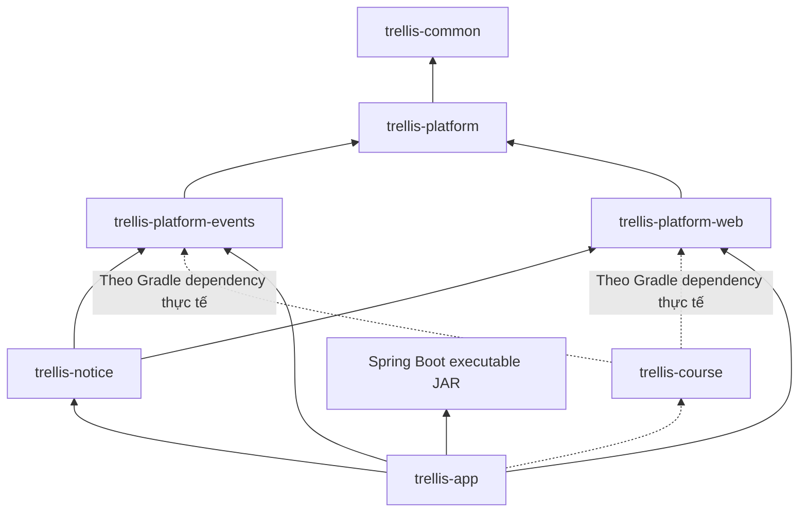
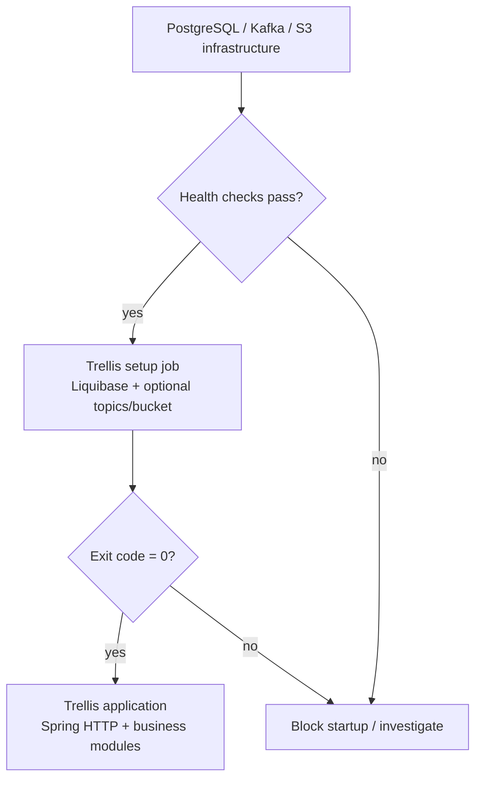
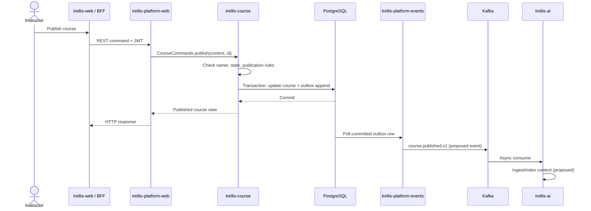

# `trellis-app` — Application Assembly, Bootstrap và Operations

> **Loại tài liệu:** Architecture / Module Guide  
> **Phạm vi:** Java Backend — Gradle project `:trellis-app`  
> **Trạng thái:** Documentation draft, dựa trên ảnh source tree và tài liệu kiến trúc hiện tại  
> **Không phải:** SRS, đặc tả nghiệp vụ LMS hoặc hướng dẫn triển khai một tính năng cụ thể

## 1. Mục đích

`trellis-app` là **ứng dụng có thể khởi động và triển khai** (*deployable application*) của Java Backend.
Đây là **composition root**: nơi lắp ráp các thư viện platform và business modules thành một Spring Boot application.

Phân biệt ba loại module:

| Loại | Ví dụ | Trách nhiệm |
| --- | --- | --- |
| **Platform libraries** | `trellis-platform`, `trellis-platform-events`, `trellis-platform-web` | Database, security, AOP, observability, Kafka/outbox, HTTP/GraphQL infrastructure |
| **Business modules** | `trellis-notice`, `trellis-course` | Entity, chính sách nghiệp vụ, application use cases, domain-specific REST/GraphQL |
| **Application assembly** | **`trellis-app`** | Khởi động Spring, chọn dependencies/configuration, cung cấp startup/setup và operational entry points |

**Quy tắc cốt lõi:** `trellis-app` **không phải** nơi chứa toàn bộ `CourseService`, `LessonRepository`, `QuizGrader`, ...; các lớp nghiệp vụ đó thuộc module sở hữu domain.

`trellis-app` là **một Spring Boot deployable**, không phải một microservice riêng cho mỗi module Java.

### Sơ đồ quan hệ



> Mũi tên tới thư viện thể hiện **phụ thuộc build/lắp ráp**, không phải HTTP call. Sơ đồ chỉ mô tả phụ thuộc đã ghi trong `docs/architecture/backend.md` đối với các module cũ. Đường nét đứt cho `trellis-course` cần đối chiếu `build.gradle.kts` vì ảnh chỉ xác nhận module có tồn tại.

## 2. Cây thư mục đang thấy trong IDE

```text
trellis-app/
├── build/                         # Output của Gradle, không phải source
├── src/
│   ├── main/
│   │   ├── java/io/trellis/app/
│   │   │   ├── api/
│   │   │   │   └── OpenApiConfiguration.java
│   │   │   ├── config/
│   │   │   │   ├── AppConfigController.java
│   │   │   │   ├── FeatureFlags.java
│   │   │   │   └── FeatureFlagSunsetCheck.java
│   │   │   ├── dev/
│   │   │   │   ├── application/
│   │   │   │   │   ├── DevPing.java
│   │   │   │   │   ├── DevPingHandler.java
│   │   │   │   │   └── DevPingService.java
│   │   │   │   └── DevOutboxController.java
│   │   │   ├── ops/
│   │   │   │   ├── application/
│   │   │   │   │   └── OpsGate.java
│   │   │   │   └── OpsController.java
│   │   │   ├── setup/
│   │   │   │   ├── S3BucketCreator.java
│   │   │   │   ├── S3Properties.java
│   │   │   │   ├── SetupProperties.java
│   │   │   │   └── SetupRunner.java
│   │   │   └── TrellisApplication.java
│   │   └── resources/               # Nội dung bên trong chưa được mở trong ảnh
│   └── test/                         # Nội dung bên trong chưa được mở trong ảnh
└── build.gradle.kts
```

**Mức độ xác nhận:** Tên folder và class lấy từ ảnh IDE. Vai trò chi tiết bên dưới được đối chiếu với `backend.md`/`delivery.md` nơi tài liệu có ghi rõ; các class chưa thấy nội dung được đánh dấu **cần xác minh source**.

## 3. Mục đích từng package và file

### 3.1. `TrellisApplication.java` — entry point

- Class khởi động Spring Boot application (vai trò xác định theo vị trí/tên file; cần mở file để xem annotation và cấu hình chính xác).
- Spring thiết lập application context, nạp bean và auto-configuration của các modules nằm trên classpath.
- `trellis-app` **lắp ráp** các business modules; không cần tạo bean của từng module bằng tay nếu module đã đăng ký auto-configuration đúng cách.

**Cần xem trong code:** `@SpringBootApplication`, `main(...)`, `scanBasePackages`/`@Import` (nếu có), các điều kiện khởi động khác.

### 3.2. `api/OpenApiConfiguration.java` — cấu hình API specification

- Cấu hình OpenAPI/springdoc ở cấp ứng dụng: server URL, bearer auth, default error schema và tags theo tài liệu hiện tại.
- **Không** viết business endpoint ở đây; controller của Course nằm trong `trellis-course`.
- `:trellis-app:exportApiContracts` khởi động assembly phục vụ export thành `contracts/openapi/openapi.json` và `contracts/graphql/schema.graphqls`.
- `:trellis-app:checkApiContracts` đối chiếu bản committed với bản export, nhằm phát hiện contract drift.

### 3.3. `config/` — cấu hình cấp ứng dụng

| File | Chức năng được tài liệu/ảnh hỗ trợ | Cần lưu ý |
| --- | --- | --- |
| `FeatureFlags.java` | Khai báo feature flags cấp ứng dụng; các cờ có owner và sunset theo pattern catalogue | Không hardcode nghiệp vụ Course vào platform |
| `FeatureFlagSunsetCheck.java` | Kiểm tra sunset của feature flags | Đọc điều kiện fail startup trong source để biết hành vi chính xác |
| `AppConfigController.java` | Expose public app configuration cho frontend | Chỉ trả về **client-visible flags**, không trả secrets hoặc internal settings |

`backend.md` mô tả endpoint public `GET /api/app-config`, ví dụ response:

```json
{"featureFlags":{"noticeSearch":false}}
```

Không tự suy luận rằng flag mới cho LMS đã tồn tại.

### 3.4. `dev/` — development/test diagnostics

| File | Ý nghĩa | Mức xác nhận |
| --- | --- | --- |
| `application/DevPing.java` | Thành phần của luồng ping thử nghiệm | Suy ra từ tên; cần đọc class |
| `application/DevPingHandler.java` | Handler của luồng ping | Suy ra từ tên; cần đọc class |
| `application/DevPingService.java` | Application service cho ping | Suy ra từ tên; cần đọc class |
| `DevOutboxController.java` | HTTP endpoint phục vụ quan sát/kiểm thử outbox trong development | Suy ra từ tên; cần xem mapping và security |

**Lưu ý bảo mật:** Package tên `dev` **không tự động** chỉ bật trên dev. Phải xác minh có `@Profile`, `@Conditional...`, hoặc security configuration ngăn truy cập trên production.

### 3.5. `ops/` — operational endpoints

| File | Vai trò | Lưu ý |
| --- | --- | --- |
| `OpsController.java` | HTTP entry point cho operational actions | Không dành cho learner/instructor thông thường |
| `application/OpsGate.java` | Application boundary/guard cho các operations | Tên class gợi ý guard; cần mở code để xác nhận các checks cụ thể |

Theo `backend.md`, `/api/ops/**` phục vụ các thao tác như **replay dead-letter events** hoặc **rebuild read models**, được kiểm tra permission, lock và audit. Đây là **quản trị vận hành**, không phải business API của LMS.

### 3.6. `setup/` — one-shot infrastructure provisioning

| File | Trách nhiệm |
| --- | --- |
| `SetupProperties.java` | Các tùy chọn setup như bật tạo Kafka topics hoặc S3 bucket |
| `S3Properties.java` | Cấu hình kết nối object storage S3-compatible |
| `S3BucketCreator.java` | Logic tạo bucket phục vụ ứng dụng |
| `SetupRunner.java` | Điều phối các setup steps sau khi application context được khởi tạo |

Đoạn code **nhìn thấy trong screenshot**:

```java
@Component
@ConditionalOnProperty(
    prefix = "trellis.setup",
    name = "enabled",
    havingValue = "true")
class SetupRunner implements ApplicationRunner {
    // ...
}
```

Nó cho biết:

1. `SetupRunner` là Spring bean **có điều kiện**; không chạy chỉ vì class nằm trong `setup/`.
2. Khi `trellis.setup.enabled=true`, bean triển khai `ApplicationRunner` được gọi ở thời điểm startup.
3. Trong `run(...)`, code nhìn thấy kiểm tra `properties.createKafkaTopics()` và `properties.createS3Bucket()` trước khi chạy từng step.
4. Tài liệu `delivery.md` mô tả một **setup job**: chờ infrastructure healthy → chạy Liquibase, tạo Kafka topics/bucket → hoàn tất → các app mới start.

`ApplicationRunner` **không phải** một API endpoint và không phải cron job. `SetupRunner` cũng không được xem là nơi định nghĩa nghiệp vụ `createCourse()` hoặc `publishLesson()`.

**Chưa xác minh từ phần ảnh:** Chi tiết implementation của `createTopics()`, cách thoát JVM và xử lý exception/exit code ở cuối `run(...)`. Muốn nói chính xác cần mở phần còn lại của `SetupRunner.java`.

### 3.7. Các thư mục còn lại

| Đường dẫn | Ý nghĩa |
| --- | --- |
| `src/main/resources/` | Configuration và application resources (ví dụ có thể gồm YAML, Liquibase changelog); cần mở để biết file thực tế |
| `src/test/` | Unit/integration tests cho assembly, setup, operational behavior và contract export |
| `build.gradle.kts` | Gradle plugins/dependencies của deployable `trellis-app`; **đọc file này trước** để biết module nào thực sự được lắp ráp |
| `build/` | Gradle-generated output: compiled classes, test reports, jar, v.v.; không sửa tay và không commit |

## 4. Startup: setup mode và application mode khác nhau ra sao?

### 4.1. Hai kiểu chạy của cùng ứng dụng

| Khía cạnh | **Setup (one-shot)** | **App (long-running)** |
| --- | --- | --- |
| Mục đích | Chuẩn bị hạ tầng/schema | Phục vụ REST/GraphQL và business use cases |
| Kích hoạt | Cấu hình setup/mode do deployment truyền vào | Cấu hình app bình thường |
| Tác vụ điển hình | Liquibase, tạo Kafka topic, S3 bucket | HTTP server, event relay/consumers theo config |
| Vòng đời | Thực hiện và thoát với status code | Giữ process chạy để phục vụ request |
| Khi thất bại | Setup job phải fail để deployment chặn bước sau | Readiness/health và xử lý lỗi runtime |

> `dev`, `test`, `prod` là các **Spring profiles**; `setup` và `migrate` được tài liệu `backend.md` mô tả là **app modes**. Không mặc định `setup` chính là một Spring profile. Cấu hình thực tế nằm ở các file env/compose và Spring properties.



Theo `delivery.md`, Docker Compose dùng `depends_on: setup: service_completed_successfully` cho ứng dụng phụ thuộc setup. Điều này giúp tránh chạy business app trước khi những bước setup bắt buộc hoàn tất.

### 4.2. Các điều cần kiểm chứng khi review setup

- Setup có **idempotent** không? Chạy lại nhiều lần có gây lỗi/duplicate topic/bucket không?
- Kafka không khả dụng thì báo lỗi hay được phép bỏ qua khi cờ tạo topic đang tắt?
- Liquibase đã chạy trước những operations nào?
- Secret S3 có bị ghi vào logs không?
- Setup có bật HTTP server hoặc consumer không cần thiết không?
- `ApplicationRunner` trả đúng exit code thất bại không?

## 5. Luồng request bình thường đi qua module nào?

Ví dụ **đề xuất cho LMS**: instructor publish một Course. Luồng này **chưa xác nhận là đã triển khai**.



**Phân vai chính xác:**

- `trellis-platform-web` cung cấp HTTP/GraphQL infrastructure, không chứa rule "khi nào được publish".
- `trellis-course` sở hữu business invariants và use cases.
- `trellis-platform` cung cấp persistence/transaction/security/AOP infrastructure.
- `trellis-platform-events` vận chuyển sự kiện qua outbox/Kafka; việc phát event là quyết định của business use case.
- `trellis-app` làm cho các thành phần trên **cùng tồn tại trong một Spring Boot runtime**.
- `trellis-ai` là process/repository Python khác; liên kết runtime qua Kafka và typed API, không phải import Java module.

## 6. Quy tắc: tính năng mới nên đặt vào đâu?

| Nếu cần... | Nơi đặt code phù hợp | Không nên đặt ở... |
| --- | --- | --- |
| Thêm business rule publish khóa học | `trellis-course/domain` hoặc `trellis-course/application` | `trellis-app/setup`, `trellis-platform` |
| Thêm Course REST controller/GraphQL resolver | `trellis-course/web` | `trellis-app/api/OpenApiConfiguration` |
| Thêm validation của một quiz | Module assessment sở hữu quiz | `trellis-app/config` |
| Thêm outbox/retry/DLQ infrastructure dùng chung | `trellis-platform-events` | Business module |
| Thêm permission checking infrastructure dùng chung | `trellis-platform` | `trellis-app/ops` |
| Thêm feature flag cấp ứng dụng | `trellis-app/config` theo convention hiện tại | `trellis-course/domain` nếu là global configuration |
| Thêm logic tạo bucket/topic khi môi trường setup | `trellis-app/setup` | `trellis-course/application` |
| Thêm endpoint vận hành để replay/rebuild | `trellis-app/ops` (qua application use cases/guard) | Public LMS controller |
| Thêm pipeline embedding/indexing | `trellis-ai` Python repo | `trellis-app/setup` |

Một business module có thể có `domain/`, `application/`, `infrastructure/`, `web/`, `api/` riêng. `api/` bên trong business module là **public Java interface cho module khác**; không đồng nghĩa với HTTP layer.

## 7. `trellis-app` liên quan gì đến `contracts/` và ba repositories?

```text
Java controller / GraphQL schema trong business modules
        |
        v
:trellis-app:exportApiContracts
        |
        +--> contracts/openapi/openapi.json
        +--> contracts/graphql/schema.graphqls
        |
        v
GitLab package publication (theo contracts.md)
        |
        +--> @trellis/contracts (npm) --> trellis-web
        +--> trellis-contracts (PyPI) --> trellis-ai

Domain event JSON Schema: contracts/events/*.schema.json
        |
        +--> generated Python event models --> trellis-ai Kafka worker
```

- `trellis-app` export **toàn bộ REST/GraphQL surface** được lắp ráp, chứ không chỉ API trong package `io.trellis.app`.
- `contracts/` thuộc backend repository; hai repo còn lại **consume package phiên bản cố định**, không copy schema thủ công.
- Event schema trong `contracts/events` là hợp đồng truyền tin; không có nghĩa mọi event đều do `trellis-app` tự xử lý.

Xem thêm [`contracts.md`](./contracts.md) và [`backend.md`](./backend.md).

## 8. Cách đọc source để hiểu đúng mà không đoán

Từ root của `trellis-backend`:

```bash
# 1. Xác định Gradle path/module dependencies (không suy ra từ thư mục)
./gradlew projects

# 2. Mở build script của app tại đường dẫn thực tế trong checkout
# (đường dẫn vật lý có thể khác tên Gradle project :trellis-app)

# 3. Tìm entry point và bean conditions
rg -n 'class TrellisApplication|class SetupRunner|ConditionalOnProperty|@Profile' . \
  --glob '*.java'

# 4. Xác định đúng đường dẫn các app-level controllers
find . -type f \( -name 'OpsController.java' -o -name 'AppConfigController.java' \
  -o -name 'DevOutboxController.java' \) -print
# Sau đó mở từng class để xem mapping/authorization thực tế

# 5. Xem nhiệm vụ export/verify contracts
./gradlew :trellis-app:tasks --all | rg 'exportApiContracts|checkApiContracts|bootJar'
```

**Thứ tự đọc hiệu quả nhất:**

1. `trellis-app/build.gradle.kts` (hoặc đường dẫn vật lý tương ứng trong checkout).
2. `TrellisApplication.java` — entry point/component scanning.
3. `src/main/resources/` — Spring properties, Liquibase và app configuration.
4. `setup/SetupProperties.java` → `setup/SetupRunner.java` → `setup/S3BucketCreator.java` — one-shot startup.
5. `api/OpenApiConfiguration.java` → `config/` — API export và client-visible config.
6. `ops/` và `dev/` — operational/dev-only entry points cùng security/conditional guards.
7. `trellis-course`/`trellis-notice` — đối chiếu một business request thực tế với các platform abstractions.

## 9. Những giả định cần xác minh trong source hiện tại

Ảnh IDE chỉ cung cấp tên class và một phần `SetupRunner`. **Chưa đủ cơ sở** để khẳng định các nội dung sau:

| Câu hỏi | File cần kiểm tra |
| --- | --- |
| `TrellisApplication` có chủ động scan/import tất cả modules không? | `TrellisApplication.java`, auto-configurations của các modules |
| `trellis-course` đã được thêm vào runtime dependencies của app chưa? | `build.gradle.kts`, `settings.gradle.kts` hoặc settings tương ứng |
| `DevOutboxController` chỉ tồn tại ở dev? | Class + security configuration + profiles |
| `OpsGate` chính xác kiểm tra permission/feature/lock gì? | `OpsGate.java`, `OpsController.java` |
| `SetupRunner` thoát application theo cách nào khi thành công/thất bại? | Phần còn lại của `SetupRunner.java` |
| Liquibase master changelog nằm file nào? | `src/main/resources/` và Spring configuration |
| `migrate` khác `setup` ở chỗ nào? | App mode configuration và startup scripts |

Không nên hoàn thiện tài liệu bằng cách đoán các implementation details này. Cập nhật bảng sau khi review source cụ thể.

## 10. Tài liệu liên quan

- [`backend.md`](./backend.md) — kiến trúc modular monolith, request lifecycle, AOP, events và API.
- [`contracts.md`](./contracts.md) — OpenAPI, GraphQL, event schemas và contract publication.
- [`delivery.md`](./delivery.md) — Docker Compose profiles, setup job, Docker images và CI/CD.
- `backend/AGENTS.md` — quy tắc code cụ thể (đường dẫn có thể phụ thuộc cách checkout).
- `plan/decisions.md` — quyết định kiến trúc nếu có trong checkout.

---

### Tóm tắt trong một câu

**`trellis-app` sở hữu việc "ứng dụng được lắp ráp, khởi động, cấu hình và vận hành như thế nào"; business modules sở hữu việc "sản phẩm LMS làm gì và tuân theo quy tắc nghiệp vụ nào".**
